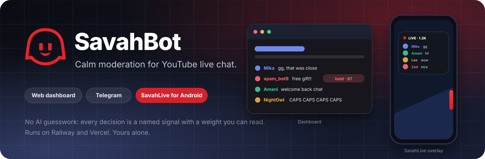
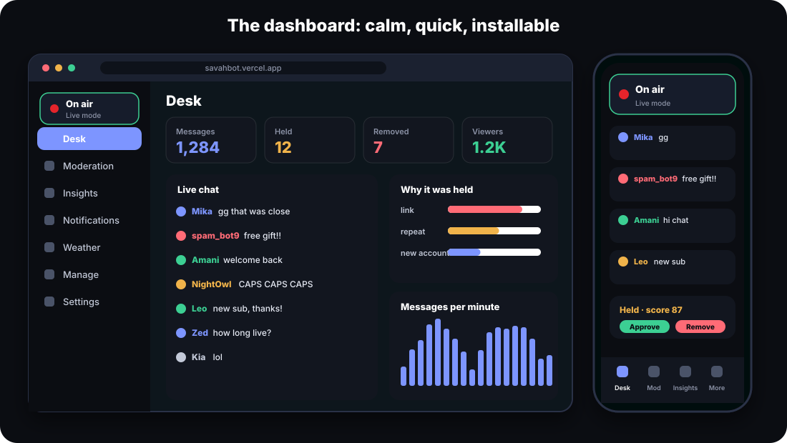
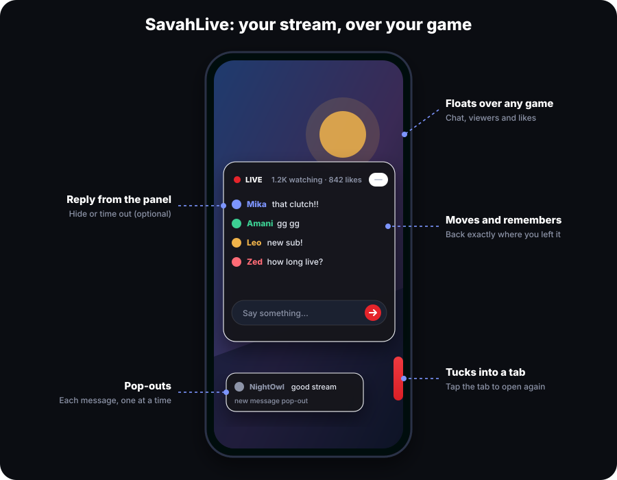
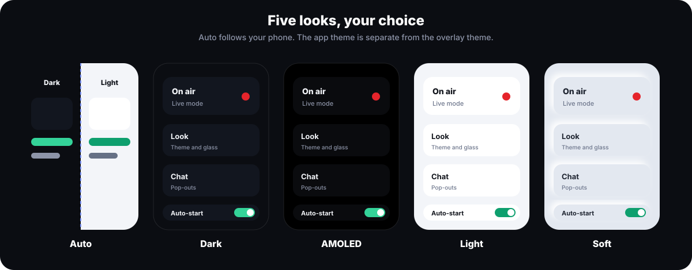
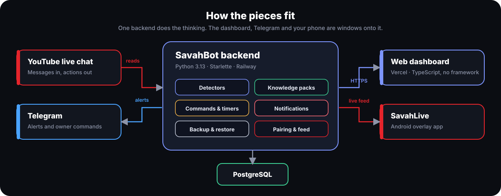
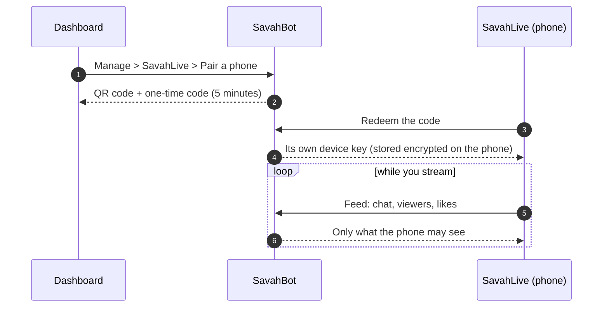

<!--
  EDIT ME: every place you may want to change is marked with "EDIT".
  1. Replace bonifacenjuguna/SavahBot (search for it) with your GitHub user and repository name.
  2. Add a row to the download table after each release (see "Downloads").
-->
<div align="center">



<br>

<p align="center">
<a href="#downloads"></a> <a href="#downloads"></a>                   
</p>

**[Downloads](#downloads)** &nbsp;·&nbsp; **[Two products](#two-products-one-repo)** &nbsp;·&nbsp; **[Screenshots](#a-look-around)** &nbsp;·&nbsp; **[How it fits](#how-it-fits-together)** &nbsp;·&nbsp; **[Quick start](#quick-start)** &nbsp;·&nbsp; **[Project insights](#project-insights)** &nbsp;·&nbsp; **[Docs](#documentation)**

</div>

<br>

SavahBot is a personal, owner-only moderation and utility bot for YouTube live chat. You run it yourself and control it from a web dashboard and from Telegram. **SavahLive** is its Android companion: it floats your stream's chat, viewers and likes over any game on your phone.

There is no AI in the loop. Moderation is a set of explainable algorithms, and every decision shows up as a named signal with a weight, so you can always see why a message scored what it did.

---

## Downloads

> **SavahLive (Android)** is the only part you download. The dashboard and the backend are deployed, not installed ([Quick start](#quick-start)).

<!-- Add the newest SavahLive release at the top. Link to the published GitHub release asset and record its published date and SHA-256 digest. -->

| | Version | Released | Download | SHA-256 | Notes |
|:-:|:--|:--|:--|:--|:--|
|  | **SavahLive 3.0.0** | **25 Nov 2026** | [**Download release asset**](https://github.com/bonifacenjuguna/SavahBot/releases/download/3.0.0/unsigned.apk) | <code>99dc3ada235c7110d19ebad48d3cf9d3caa47bc9ae1d36aeb80c8fc76eff07b7</code> | [Release notes](https://github.com/bonifacenjuguna/SavahBot/releases/tag/3.0.0) |

<sub>**Release asset note:** GitHub currently lists the uploaded file as `unsigned.apk`. The SHA-256 above is GitHub's asset digest for that exact file. Verify its signing status before distributing it as an installable release. The signed, versioned APK folder described in [the release guide](docs/RELEASING.md) is not present in the repository yet.</sub>

<details>
<summary><b>Verify the downloaded release asset</b></summary>

Expected SHA-256:

```text
99dc3ada235c7110d19ebad48d3cf9d3caa47bc9ae1d36aeb80c8fc76eff07b7
```

Windows PowerShell:

```powershell
Get-FileHash unsigned.apk -Algorithm SHA256
```

macOS / Linux:

```bash
sha256sum unsigned.apk
```

The result must match the hash above exactly.

</details>

### Source and developer downloads

| What | Download | Size | For |
|:--|:--|:--|:--|
| **Android source only** (`android/`, excludes build output and signing keys) | [**SavahLive-android-source.zip**](https://github.com/bonifacenjuguna/SavahBot/raw/refs/heads/main/downloads/SavahLive-android-source.zip) | **141 KB** (144,353 bytes) | Building SavahLive in Android Studio or with Gradle |
| **Whole repository** (dashboard + backend + Android app) | [**Download ZIP**](https://github.com/bonifacenjuguna/SavahBot/archive/refs/heads/main.zip) | Varies | Full source, deployment and development |
| **Frontend only** | [Download frontend folder ZIP](https://download-directory.github.io/?url=https://github.com/bonifacenjuguna/SavahBot/tree/main/frontend) | Varies | Dashboard development |
| **Backend only** | [Download backend folder ZIP](https://download-directory.github.io/?url=https://github.com/bonifacenjuguna/SavahBot/tree/main/backend) | Varies | API and service development |

<sub>The Android source ZIP is a separate, clean source package; it is not an APK. Folder-only downloads use an external directory-download service. For a trusted, complete copy, use GitHub's whole-repository ZIP or clone the repository. Refresh the Android source ZIP after changing the app: `python scripts/pack_android.py`.</sub>

<sub>**Installation status:** the current release asset is named `unsigned.apk`. Do not treat it as an end-user-ready APK until its signing status is confirmed and a properly signed release build is published. Once the signed build is available, install it from the release page and pair it through **Manage › SavahLive** in the dashboard.</sub>

---

## Two products, one repo

The dashboard and the Android app are different projects with different release rhythms, so they have **different version numbers**.

| |  **SavahBot** |  **SavahLive** |
|:--|:--|:--|
| **What it is** | The brain: moderation, commands, timers, notifications, weather, history, backup | A floating window for your phone: chat, viewers, likes |
| **Where it runs** | Railway (backend) and Vercel (dashboard) | On your Android phone, over any other app |
| **Made with** | Python 3.13, Starlette, TypeScript | Kotlin, plain Android Views, no third-party libraries |
| **Version** | **2.0.0** | **3.0.0** |
| **Folders** | `backend/`, `frontend/` | `android/` |
| **You get it by** | Deploying it ([DEPLOYMENT](docs/DEPLOYMENT.md)) | Downloading the APK ([above](#downloads)) |
| **Talks to** | YouTube, Telegram, Firebase, Open-Meteo | Only your SavahBot, never YouTube |
| **Can moderate?** | Yes: delete, hold, time out, ban | Optional: hide a message or time out for 5 minutes, per phone |
| **Release** | `python scripts/bump_version.py web X.Y.Z`, then redeploy | `python scripts/bump_version.py app X.Y.Z`, then `release-savahlive.ps1` |

---

## A look around

<p align="center">
  
</p>

<p align="center">
  
</p>

<p align="center">
  
</p>

<sub>Illustrations drawn for this README. They show the layout and colours, not live data.</sub>

---

## What you get

| | |
|:--|:--|
| 🛡️ **Explainable moderation** | Every message is scored by named signals with weights. Open any decision and see exactly why. Held, removed, approved: all logged. |
| 🧠 **Knowledge packs and detectors** | Packs of patterns for spam, scams and abuse, plus detectors that read them. Set each one *Off*, *Shadow* (watch only) or *Live*. It learns from your Approve and Reject, by counting, with no AI service. |
| 🧪 **Demo mode** | Simulated chat and nine scenarios (raid, link spammer, caps flood, bot timing, disguised words and more). Nothing touches YouTube or Telegram and no quota is used. |
| 💬 **Commands and timers** | Auto-replies, timers that post while you are live, your own `$(variables)`. |
| ✈️ **Telegram** | Alerts and owner commands, by webhook or polling, switchable any time. |
| 🔔 **Notification Centre** | A bell in the app, push on phone and desktop, quiet hours. |
| 🌦️ **Weather** | Open-Meteo forecasts and alerts for the places you choose. |
| 📈 **History and insights** | Long-term history with interactive charts, per stream. |
| 🔐 **Careful sign-in** | Password, passkeys, authenticator app, recovery codes, and a lockdown switch that signs everything else out. |
| 💾 **Encrypted backup** | One `.svbak` file you can export, import and restore piece by piece, with an undo. |
| 📱 **Installable** | A progressive web app for phone, tablet and desktop, with offline pages. |
| 🎙️ **Chat reader** | Reads chat aloud with a neural voice, with per-person voices. |
| 🧩 **SavahLive** | The Android overlay: pair once, then it just works. Five themes, a panel that remembers where you left it, and pop-outs for each message. |

---

## How it fits together

<p align="center">
  
</p>



The phone never talks to YouTube and holds no YouTube credentials. A device key opens exactly one door, the overlay feed. Details: [docs/SAVAHLIVE.md](docs/SAVAHLIVE.md).

---

## Technology and infrastructure

- **Backend** (`backend/`): Python 3.13, Starlette and uvicorn. PostgreSQL in production, SQLite for local use. Runs on Railway.
- **Dashboard** (`frontend/`): Vite and TypeScript with no framework. Responsive for phone, tablet and desktop, installable. Runs on Vercel.
- **SavahLive** (`android/`): Kotlin, programmatic Views, no third-party libraries. Android 8.0 or newer.
- **Telegram**: webhook or polling, switchable from the dashboard or with `/tgmode`.

---

## Quick start

**Run it locally**

```bash
cd backend && python -m venv .venv && source .venv/bin/activate
pip install -r requirements-dev.txt
uvicorn app.main:create_app --factory --reload --port 8000
cd ../frontend && npm install && VITE_API_URL=http://localhost:8000 npm run dev
```

On first start a generated owner password is printed in the log (or set `OWNER_PASSWORD`). Details: [docs/TESTING.md](docs/TESTING.md).

**Deploy it:** Railway for the backend, Vercel for the dashboard. Step by step in [docs/DEPLOYMENT.md](docs/DEPLOYMENT.md).

**Build the Android app** (or [download the folder](#source-and-developer-downloads) first):

```powershell
cd android
gradle clean assembleDebug
# the APK: app\build\outputs\apk\debug\app-debug.apk
```

After installing, the footer in the app's Settings shows the version. If it is not the one you built, the build failed and the old APK was installed: read the Gradle output.

---

## Versions and releases

| I want to | Run |
|:--|:--|
| See both versions | `python scripts/bump_version.py --show` |
| Release a new SavahBot (dashboard + backend) | `python scripts/bump_version.py web 2.0.1` · add `## SavahBot 2.0.1` to [CHANGELOG](CHANGELOG.md) · commit · redeploy |
| Release a new SavahLive (Android) | `python scripts/bump_version.py app 3.0.1` · add `## SavahLive 3.0.1` to the changelog · `scripts\release-savahlive.ps1` · commit `releases/` |
| Check every place agrees | `python scripts/bump_version.py --check` |
| Refresh the Android source zip | `python scripts/pack_android.py` |

Versions only go up, because Android refuses to install an older build over a newer one. Full guide: [docs/RELEASING.md](docs/RELEASING.md). Everything that ever changed: [CHANGELOG.md](CHANGELOG.md).

---

## Documentation

| I want to | Read |
|:--|:--|
| Deploy it | [docs/DEPLOYMENT.md](docs/DEPLOYMENT.md) |
| Know every setting | [docs/ENVIRONMENT.md](docs/ENVIRONMENT.md) |
| Protect sign-in | [docs/SECURITY.md](docs/SECURITY.md) |
| Get push notifications | [docs/NOTIFICATIONS.md](docs/NOTIFICATIONS.md), [docs/PWA_AND_PUSH_PLATFORMS.md](docs/PWA_AND_PUSH_PLATFORMS.md) |
| Add weather | [docs/WEATHER.md](docs/WEATHER.md) |
| Float my stream over other apps (Android) | [docs/SAVAHLIVE.md](docs/SAVAHLIVE.md), [android/README.md](android/README.md) |
| Release a new version of the Android app | [docs/RELEASING.md](docs/RELEASING.md) |
| Understand how messages are scored | [docs/MODERATION.md](docs/MODERATION.md), [docs/KNOWLEDGE.md](docs/KNOWLEDGE.md) |
| Back up and restore | [docs/BACKUP_AND_RECOVERY.md](docs/BACKUP_AND_RECOVERY.md) |
| Fix a problem | [docs/TROUBLESHOOTING.md](docs/TROUBLESHOOTING.md) |
| Everything else | [docs/README.md](docs/README.md) |

---

## Project insights

A practical overview of how SavahBot is deployed, how access is protected, how its two products evolve, and where testing still has limits.

<details>
<summary><b>01 · Deployment & infrastructure</b></summary>

- **Backend — Railway:** runs the Python API and connects to PostgreSQL. SQLite is available for local development.
- **Dashboard — Vercel:** serves the TypeScript/Vite web app and communicates with the backend.
- **SavahLive — Android:** a native Kotlin app that connects to the SavahBot API for its overlay feed.

Backend and dashboard deployments are separate: changing one does not automatically publish the other. See [the deployment guide](docs/DEPLOYMENT.md) for setup steps and environment variables.

</details>

<details>
<summary><b>02 · Security & privacy</b></summary>

SavahBot is designed for one owner. Dashboard sign-in supports a password, passkeys, authenticator codes and recovery codes. Once a second method is configured, sign-in requires any two different methods.

SavahLive does **not** receive your YouTube credentials and does not connect to YouTube. Each paired phone receives its own device key, protected on the phone with Android Keystore; the server stores a hash of that key. The key is limited to the overlay feed and related device operations.

A paired phone can display live chat. Review pairing alerts and remove devices you no longer use. See the [security guide](docs/SECURITY.md) and [SavahLive guide](docs/SAVAHLIVE.md).

</details>

<details>
<summary><b>03 · Versioning & updates</b></summary>

SavahBot and SavahLive have independent version numbers because they are released separately. Dashboard/backend changes follow the web release process; Android changes are built and published as a separate SavahLive release.

A web deployment does not require a new APK, and an APK update does not require a web deployment. See [the release guide](docs/RELEASING.md).

</details>

<details>
<summary><b>04 · Testing & verification</b></summary>

Automated tests check application logic and simulated integrations. They do not prove that every live provider, browser prompt, device or production deployment works.

The [testing guide](docs/TESTING.md) lists automated coverage, known gaps and manual checks. The verification summary below separates those categories.

</details>

---

## What is and is not verified

This project has meaningful automated coverage, but **a passing test suite is not the same as a fully verified production system**.

| Area | Automated or documented coverage | Still needs real-world verification |
|:--|:--|:--|
| **Backend logic** | Unit and HTTP-level tests cover notifications, weather handling, security flows, backup/restore, history, bans and moderation knowledge. | Behaviour under actual production traffic and configuration. |
| **External services** | YouTube, Firebase and Open-Meteo are represented by fakes or fixtures in automated tests. | Real YouTube API access, Firebase push delivery and live Open-Meteo responses. |
| **Authentication** | Password hashing, TOTP, recovery codes and passkey verification are tested, including simulated authenticator flows. | Real browser passkey ceremonies and physical security keys across devices. |
| **Database** | SQLite is used for local development and automated tests. A PostgreSQL check script is provided. | A live PostgreSQL connection and migration check in the deployed environment. |
| **Frontend & deployment** | The testing guide documents the TypeScript check and production build commands. | Real browser permissions, deployed Vercel/Railway behaviour and push-token registration. |
| **Android** | SavahLive has been built and run as a debug build on a real phone, as documented in its guide. | Broad device/Android-version coverage, manufacturer battery restrictions and release signing/install verification. |

### Before relying on a deployment

- [ ] Confirm the backend health endpoint responds successfully.
- [ ] Run the PostgreSQL check script against the deployed database.
- [ ] Sign in and test the configured authentication methods.
- [ ] Enable push notifications and send a real test notification.
- [ ] Add a weather location and confirm live data loads.
- [ ] Export a backup and test its import flow.
- [ ] Pair SavahLive, check the overlay on your phone, then remove the device and confirm access is revoked.

**Important:** the current SavahLive 3.0.0 GitHub release asset is named unsigned.apk. Its published SHA-256 verifies the downloaded file's integrity; it does **not** prove that the APK is signed or safe to install. Do not treat it as an end-user-ready release until signing has been confirmed and a properly signed build is published. See [Downloads](#downloads) and [the release guide](docs/RELEASING.md).

For the full test inventory and commands, see [docs/TESTING.md](docs/TESTING.md). For deployment checks, see [docs/DEPLOYMENT.md](docs/DEPLOYMENT.md).

---
<div align="center">
<sub>## Project status

**SavahBot 2.0.0 is the completed project release.** This repository is being preserved as the finished public record of the work. No further feature development is planned.

SavahBot (dashboard and backend) and SavahLive (Android companion) retain separate version numbers and release histories. The documented limitations and verification gaps above remain part of the project record.

---

Made for one streamer's chat, kept simple on purpose. · <a href="#downloads">Back to the top</a></sub>
</div>
